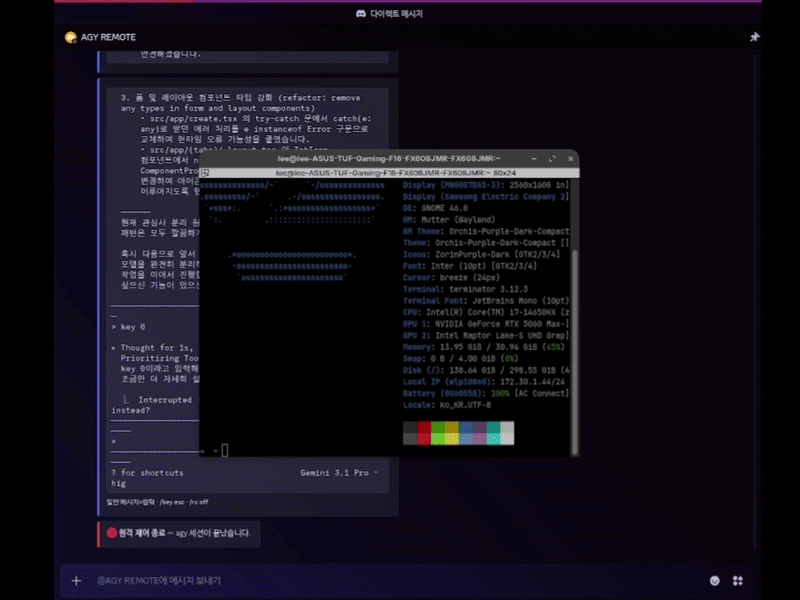
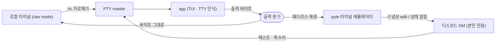
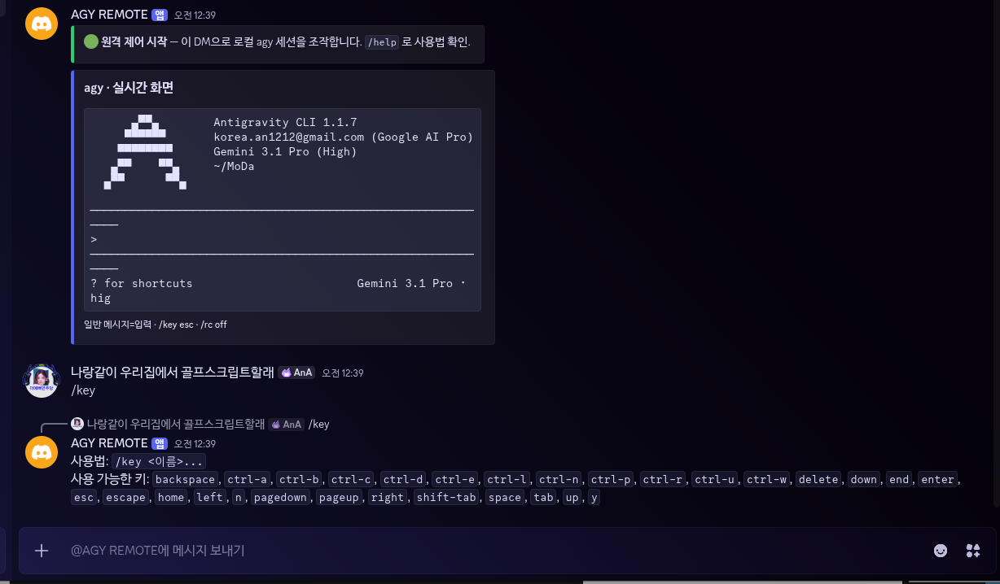

<div align="center">

# discord-agy-remote

**로컬 Antigravity CLI(`agy`) 세션을 디스코드 DM으로 원격 조작하는 셀프 호스팅 브릿지**

[](https://github.com/seohuda/discord-agy-remote/actions/workflows/tests.yml)
[](https://github.com/seohuda/discord-agy-remote/releases/latest)
[](https://www.python.org/)
[](https://discordpy.readthedocs.io/)
[](LICENSE)

[동작 방식](#동작-방식) · [빠른 시작](#빠른-시작) · [디스코드 봇 만들기](#디스코드-봇-만들기) · [사용법](#사용법) · [알림](#알림) · [보안](#보안) · [개발](#개발)

<br />



<br />

*노트북을 켜둔 채 자리를 비워도, `agy`가 승인을 기다리는 순간에만 폰이 울립니다.*

</div>

---

`agy`를 의사 터미널(PTY) 위에서 실행하기 때문에, 로컬 터미널에서는 평소와 **완전히 동일한 TUI**를 그대로 쓰면서 동시에 디스코드 DM으로도 같은 세션을 조작할 수 있습니다.

<table>
  <tr>
    <td width="50%">
      <strong>PTY 완전 호환</strong><br />
      파이프 대신 실제 PTY 위에서 <code>agy</code>를 실행합니다. 창 크기(<code>TIOCSWINSZ</code>)와 <code>SIGWINCH</code> 리사이즈도 그대로 전달됩니다.
    </td>
    <td width="50%">
      <strong>실시간 화면 스냅샷</strong><br />
      원시 제어문자 대신 <code>pyte</code> 에뮬레이터로 현재 화면만 뽑아내고, DM 메시지 하나를 조용히 <code>edit</code>해 갱신합니다.
    </td>
  </tr>
  <tr>
    <td width="50%">
      <strong>상태 기반 푸시 알림</strong><br />
      진행 중에는 조용히 화면만 갱신하고, <strong>승인 대기 진입</strong>과 <strong>작업 완료</strong> 순간에만 새 메시지를 보내 폰에 알림을 띄웁니다.
    </td>
    <td width="50%">
      <strong>셀프 호스팅 · 로컬 우선</strong><br />
      외부 프록시 서버 없이 본인 디스코드 봇 토큰만 사용합니다. DM이면서 본인 <code>DISCORD_USER_ID</code>인 요청만 허용합니다.
    </td>
  </tr>
</table>

---

## 동작 방식



* **PTY 기반**: `agy`는 stdin/stdout이 TTY가 아니면 TUI를 띄우지 않고 1회성 print 모드로 떨어집니다. 파이프 대신 PTY를 물려 실제 터미널로 인식시킵니다.
* **화면 스냅샷 전송**: TUI는 커서를 옮겨 화면을 계속 덧그리기 때문에 출력 바이트를 그대로 보내면 제어문자 범벅이 됩니다. 출력을 `pyte` 터미널 에뮬레이터에 재생해 **현재 화면 상태**만 뽑아내고, DM 메시지 하나를 계속 `edit`해서 갱신합니다.
* **상태 기반 알림**: 디스코드는 메시지 `edit`에 푸시 알림을 보내지 않습니다. 화면을 감시해 **승인 대기 진입**과 **작업 완료** 시점에만 새 메시지를 보내 알림이 뜨게 합니다.
* **로컬 명령 가로채기**: 로컬 터미널은 raw 모드라 줄 단위 입력이 없습니다. 줄 시작에서 `/rc ...` 접두사인 동안만 입력을 붙잡아 두었다가 명령이 완성되면 소비하고, 경로·일반 문장·붙여넣기나 `agy` 자체 슬래시 명령(`/model` 등)은 그대로 흘려보냅니다.

---

## 빠른 시작

### 요구사항

* **Python 3.10** 이상
* `PATH`에 설치된 **Antigravity CLI(`agy`)**
* **디스코드 봇 토큰** 및 본인 **User ID** (개발자 포털에서 **Message Content Intent** 활성화 필수)

### 설치

```bash
git clone https://github.com/seohuda/discord-agy-remote.git
cd discord-agy-remote
./install.sh
source ~/.zshrc   # 또는 ~/.bashrc
```

`install.sh`는 `.venv` 가상환경 생성, 의존성 설치, `.env` 생성(`chmod 600`), 셸 alias 등록(기존 설정 백업 포함)까지 한 번에 처리합니다.

### 환경변수 설정

프로젝트 루트의 `.env` 파일을 열어 필수 항목을 채웁니다.

```dotenv
DISCORD_TOKEN=봇_토큰
DISCORD_USER_ID=본인_디스코드_유저_ID
```

<details>
<summary><strong>선택 환경변수 보기</strong> (<code>DISHELL_COLS</code>, <code>DISHELL_AGY_BIN</code>, <code>DISHELL_DEBUG</code>)</summary>

<br />

| 변수 | 기본값 | 설명 |
| --- | --- | --- |
| `DISHELL_COLS` | `60` | 원격 제어 중 `agy`가 그릴 화면 너비입니다. 디스코드 코드블록이 60칸 근처에서 접히기 때문에 `/rc on` 때 좁혔다가 `/rc off` 때 원래 너비로 되돌립니다. `0`이면 터미널 너비를 그대로 씁니다. 폰에서 주로 본다면 `50` 정도가 보기 좋습니다. |
| `DISHELL_AGY_BIN` | `agy` | 실행할 Antigravity CLI 실행 파일 이름입니다. `PATH`에서 찾습니다. |
| `DISHELL_DEBUG` | *(없음)* | 지정한 파일 경로에 stdin 바이트와 필터 판정·진단 로그를 기록합니다. |

</details>

---

## 디스코드 봇 만들기

봇을 처음 만든다면 아래 순서대로 진행합니다.

1. **앱 생성** — [Discord Developer Portal](https://discord.com/developers/applications)에서 `New Application`을 누릅니다.
2. **토큰 발급** — 좌측 `Bot` 메뉴에서 `Reset Token`을 눌러 토큰을 복사해 `.env`의 `DISCORD_TOKEN`에 넣습니다.
3. **Intent 켜기** — 같은 `Bot` 메뉴의 `Privileged Gateway Intents`에서 **Message Content Intent**를 켭니다. 이 설정이 꺼져 있으면 봇이 DM 본문을 읽지 못합니다.
4. **서버에 초대** — `OAuth2` → `URL Generator`에서 `SCOPES`의 `bot`과 **`applications.commands`**를 함께 체크합니다. 생성된 URL을 열어 본인 서버에 초대합니다.

> [!IMPORTANT]
> **봇과 같은 서버에 하나 이상 함께 있어야 합니다.**
> 디스코드는 상호 서버가 없는 상대에게 봇이 DM을 보내는 것을 막습니다(403). 본인만 있는 비공개 서버를 하나 만들어 봇을 초대해두세요. `/rc on`은 연결 직후 실제로 DM을 한 번 보내보고, 실패하면 원인을 로컬 터미널에 출력한 뒤 원격 제어를 켜지 않습니다.

<p align="center">
  
</p>

`/`를 치면 뜨는 자동완성 목록에서 고르거나 일반 텍스트로 쳐도 됩니다. `/key`, `/rc`, `/say`, `/help` 모두 양쪽 방식으로 동일하게 동작합니다.

> [!TIP]
> **슬래시 명령이 자동완성에 안 보일 때**
> 방금 봇을 초대했다면 디스코드 클라이언트 캐시 때문입니다. <kbd>Ctrl</kbd> + <kbd>R</kbd>(macOS는 <kbd>Cmd</kbd> + <kbd>R</kbd>)로 새로고침하면 자동완성 목록에 나타납니다.

---

## 사용법

### 로컬 터미널에서 켜고 끄기

평소처럼 `agy`를 실행합니다. 인자도 그대로 전달됩니다(`agy -c`, `agy --model ...`).

```bash
agy
```

실행 직후 아래 한 줄이 보이면 래퍼가 정상 동작 중인 것입니다.

```text
[Dishell] 원격 제어 대기 중 · 세션에서 /rc on
```

줄 시작에서 `/rc`를 입력하면 `agy` 입력창 대신 **화면 맨 아래 상태줄**에 표시됩니다.

```text
[Dishell] /rc on
```

여기서 <kbd>Backspace</kbd>로 고치거나 <kbd>Ctrl</kbd> + <kbd>U</kbd>로 취소할 수 있고, <kbd>Enter</kbd>를 치면 실행됩니다. 이 입력은 `agy`에 전혀 전달되지 않습니다.

> [!TIP]
> **래퍼가 붙었는지 헷갈릴 때**
> 빈 입력줄에서 `/rc`를 쳐보세요. 맨 아래 상태줄에 나타나면 래퍼가 붙은 것이고, `agy` 입력창에 그대로 들어가면서 자동완성 메뉴가 뜨면 alias가 적용되지 않은 것입니다.

| 로컬 터미널 명령 | 동작 |
| --- | --- |
| `/rc on` | 디스코드 봇 연결, 원격 제어 시작 |
| `/rc off` | 원격 제어 종료, 봇 연결 해제 |
| `/rc status` | 현재 원격 제어 상태 및 `agy` PID 확인 |

### 디스코드 DM에서 조작하기

자동완성 슬래시 명령과 일반 DM 텍스트 모두 동일하게 동작합니다.

| 디스코드 DM 명령 | 동작 |
| --- | --- |
| *(아무 텍스트)* | `agy` 입력창에 입력 후 전송 (여러 줄은 bracketed paste로 한 번에 입력) |
| `/say <텍스트>` | `/model`·`/rc off`처럼 슬래시로 시작하는 내용도 가로채지 않고 그대로 입력 |
| `/key esc` | 특수키 전송 |
| `/key down down enter` | 여러 키 순서대로 전송 (메뉴·승인 프롬프트 조작용) |
| `/rc off` | 원격에서 원격 제어 종료 |
| `/rc status` | 세션 상태·PID·화면 크기 확인 |
| `/help` | 사용법과 키 목록 표시 |
| `//텍스트` | 앞 슬래시 하나를 벗겨 그대로 전송 |

`/model`처럼 `agy` 자신의 슬래시 명령은 가로채지 않고 그대로 전달됩니다.

<details>
<summary><strong>사용 가능한 특수키 전체 목록</strong></summary>

<br />

| 분류 | 키 이름 |
| --- | --- |
| **확인 · 이동** | `enter` `esc` `escape` `tab` `shift-tab` `space` `up` `down` `left` `right` `home` `end` `pageup` `pagedown` |
| **편집** | `backspace` `delete` |
| **제어 키** | `ctrl-a` `ctrl-b` `ctrl-c` `ctrl-d` `ctrl-e` `ctrl-l` `ctrl-n` `ctrl-p` `ctrl-r` `ctrl-u` `ctrl-w` *(대소문자 무관, `ctrl+c` 표기도 허용)* |
| **단축 응답** | `y` `n` |

</details>

### 메뉴에서 항목 고르기

모델 선택이나 권한 승인처럼 화면에 목록이 뜨면, 커서(`>`)를 옮긴 뒤 확정하는 식으로 조작합니다. 화면 하단 푸터가 어떤 키를 쓰는지 알려줍니다.

```text
  > Gemini 3.1 Pro
    Claude Opus 4.6
    GPT-5.2
  ↑/↓ Navigate · enter Select · esc Go Back
```

두 칸 아래 항목을 고르려면 이동과 확정을 한 번에 보냅니다.

```text
/key down down enter
```

승인 프롬프트도 같은 방식입니다. `/key down enter`로 두 번째 선택지를, `/key esc`로 취소를 보냅니다.

---

## 알림

봇이 먼저 DM을 보냅니다. 말을 걸어야 응답하는 구조가 아닙니다.

진행 중인 화면은 메시지 하나를 계속 `edit`해서 조용히 갱신하고, 아래 두 순간에만 **새 메시지**를 보내 푸시 알림이 뜨게 합니다.

| 상황 | 푸시 알림 |
| --- | --- |
| `agy`가 승인·선택 프롬프트를 띄움 | ⏸️ **입력 대기 중** — agy가 승인을 기다리고 있습니다. |
| 작업이 끝나고 화면이 3초 이상 조용함 | ✅ **작업 완료** — agy가 유휴 상태입니다. |

감지는 `agy`가 실제로 출력하는 문구를 기준으로 합니다. `Do you want to proceed?`, `Allow access to this file?`, `Do you trust the contents of this project?` 같은 알려진 문구에 더해, 화면 하단의 `↑/↓ Navigate · enter Confirm` 푸터를 일반 신호로 사용하기 때문에 목록에 없는 새 프롬프트도 잡힙니다. 작업 중 여부는 `esc to interrupt` 표시로 판단합니다.

---

## 보안

* 원격 입력(일반 DM과 슬래시 명령 모두)은 **DM**이면서 **`DISCORD_USER_ID`와 정확히 일치하는 발신자**인 경우에만 받아들입니다. 서버 채널이나 타인의 메시지는 모두 차단합니다.
* `DISCORD_USER_ID`가 비어 있으면 `0`이 되어 아무도 통과하지 못합니다(fail-closed).
* 봇 토큰은 `.env`에 보관되며 `.gitignore`에 포함되어 있습니다. `install.sh`는 `.env` 권한을 `600`으로 설정합니다.

> [!CAUTION]
> 원격 제어는 사실상 로컬 셸 접근과 동등한 권한입니다. `--dangerously-skip-permissions`와 함께 쓰면 승인 없이 도구가 실행되므로 특히 주의하세요.

---

## 참고: `agy --remote-control`과의 차이

`agy`에는 자체 원격 제어 모드(`--remote-control`)가 내장되어 있으며, 이는 Antigravity 자체 프록시 서버를 경유하는 클라우드 방식입니다. 이 프로젝트는 그 경로를 쓰지 않고 **본인 디스코드 봇만으로 자체 호스팅**한다는 점이 다릅니다.

---

## 개발

```bash
.venv/bin/pip install -r requirements-dev.txt
.venv/bin/pytest
```

푸시와 PR마다 Python 3.10 · 3.12 환경에서 전체 테스트 스위트가 자동 실행됩니다([`.github/workflows/tests.yml`](.github/workflows/tests.yml)).

<details>
<summary><strong>모듈 구조 보기</strong></summary>

<br />

| 모듈 | 역할 |
| --- | --- |
| [`dishell/terminal.py`](dishell/terminal.py) | PTY 생성, 로컬 터미널 raw 모드, 창 크기 전달 및 상태줄 렌더링 |
| [`dishell/screen.py`](dishell/screen.py) | `pyte` 기반 화면 에뮬레이션, 스크롤 히스토리, 디스코드 청크 렌더링 |
| [`dishell/alerts.py`](dishell/alerts.py) | 승인 대기 / 작업 완료 상태 전이 감지 |
| [`dishell/launch.py`](dishell/launch.py) | 실제 `agy` 실행 파일 확인 및 자기 참조(무한 재귀) 차단 |
| [`dishell/localcmd.py`](dishell/localcmd.py) | 로컬 raw 입력에서 `/rc` 명령 가로채기 |
| [`dishell/keys.py`](dishell/keys.py) | 특수키 이름 → 터미널 이스케이프 시퀀스 매핑 |
| [`dishell/commands.py`](dishell/commands.py) | 디스코드 메시지 → 동작 파싱 |
| [`dishell/bot.py`](dishell/bot.py) | 디스코드 클라이언트, 슬래시 명령 등록, 발신자·DM 인증 |
| [`dishell/manager.py`](dishell/manager.py) | 전체 배선, 봇 수명주기, 화면 발행 루프 |

</details>

---

## 알려진 제약

* 긴 출력은 화면 위로 흘러간 스크롤 히스토리까지 모아 최대 4개 메시지로 나눠 보냅니다. 그보다 많으면 가장 오래된 상단이 생략됩니다.
* ANSI 색상은 전달되지 않고 코드블록 안 단색 텍스트로 표시됩니다.
* 화면 갱신은 디스코드 API Rate Limit을 피하기 위해 1.5초 간격으로 동작합니다.
* 봇 수명이 `agy` 프로세스에 묶여 있습니다. **`agy`가 떠 있지 않으면 디스코드에서 새 세션을 시작할 수 없습니다.** 반드시 로컬에서 `agy` 실행 후 `/rc on`을 입력해야 합니다.
* 알림 감지는 화면 문구 기반이므로, `agy`가 UI 문구를 변경하면 [`dishell/alerts.py`](dishell/alerts.py)의 마커를 갱신해야 할 수 있습니다.

---

## 라이선스

[MIT](LICENSE)
