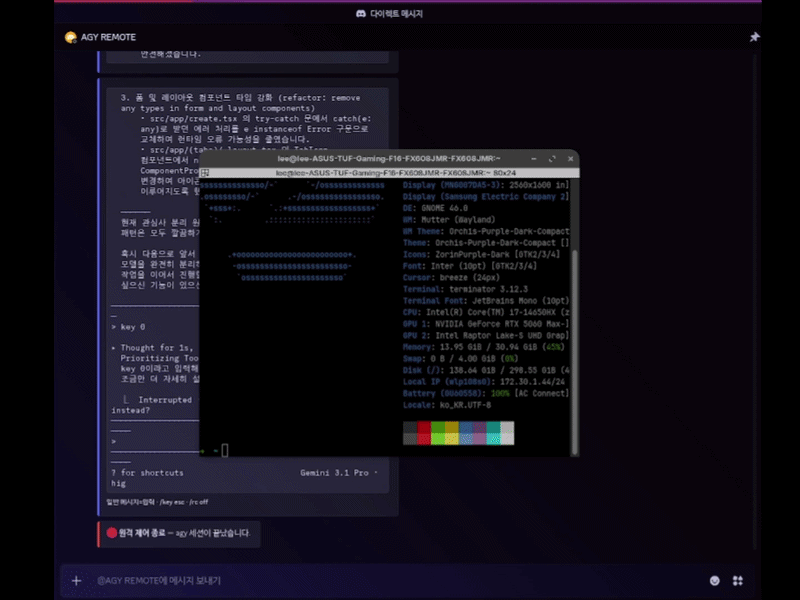

# discord-agy-remote

[](https://github.com/seohuda/discord-agy-remote/actions/workflows/tests.yml)
[](LICENSE)
[](https://www.python.org/)

Antigravity CLI(`agy`), Codex, Claude Code, OpenCode를 로컬 PTY에서 실행하고, **소유자의 Discord DM 한 곳**에서 조회·조작하는 셀프 호스팅 브릿지입니다. 로컬에서는 기존 TUI를 사용합니다. 원격은 기본 읽기 전용이며 **각 입력과 관리 작업마다 일회성 버튼 승인**이 필요합니다.



기존 데모/스크린샷은 승인 UI 추가 전 모습입니다. 실제 Discord 및 네 CLI를 이용한 새 기능의 종단 간 실환경 검증은 아직 하지 않았습니다. 테스트는 Fake Discord, Fake PTY와 실제 테스트용 CLI 프로세스로 수행합니다.

## 설치와 기존 AGY 사용자 마이그레이션

Linux, Python 3.10 이상, 사용할 CLI의 로컬 설치가 필요합니다. CLI 로그인·라이선스·API 사용료는 각 도구에서 별도로 관리합니다. CLI가 없으면 설치 오류를 안내하며 다른 프로그램을 대신 실행하지 않습니다.

```bash
git clone https://github.com/seohuda/discord-agy-remote.git
cd discord-agy-remote
python3 -m venv .venv
.venv/bin/python -m pip install -r requirements.txt
cp .env.example .env
# .env의 DISCORD_TOKEN / DISCORD_USER_ID를 본인 값으로 설정
.venv/bin/python main.py
```

기존 `install.sh`와 `agy` alias, `main.py` 진입점은 유지됩니다. 기존 사용자는 코드를 업데이트하고 가상환경 의존성을 설치한 뒤 평소처럼 실행합니다.

```bash
agy
# 로컬 TUI에서 /rc on
```

`agy --model ...` 등 로컬 인자도 그대로 전달합니다. `install.sh`는 셸 프로필/alias를 수정하므로 Codex Cloud나 CI에서는 실행하지 마세요. 개인 컴퓨터에서 alias를 처음 설정할 때만 스크립트 내용을 검토해 사용하거나, 위 수동 실행 경로를 쓰세요.

**원격 동작 변경:** `/rc on`은 연결과 VIEW만 활성화합니다. 예전처럼 DM·`/key`·`/say`를 즉시 PTY에 쓰지 않습니다. 각 작업의 확인 버튼을 눌러야 하며, `/rc off`·세션 전환·시작·종료도 확인 대상입니다. 로컬 입력에는 Discord 승인을 요구하지 않습니다.

## 다중 CLI 실행과 설정

추가 진입점은 기존 `agy` 인자를 가로채지 않습니다.

```bash
.venv/bin/python -m dishell --cli agy
.venv/bin/python -m dishell --cli codex --remote
.venv/bin/python -m dishell --cli claude -- --model sonnet
.venv/bin/python -m dishell --cli opencode
```

`--remote`는 시작할 때 Discord에 연결합니다. 생략하면 로컬 `/rc on`으로 연결합니다. `--` 뒤 인자는 로컬에서만 지정할 수 있습니다. Discord의 `/session start`는 플러그인 이름 하나만 받으며 실행 경로·실행 옵션·셸 명령 등록을 허용하지 않습니다.

`.env` 예:

```dotenv
DISCORD_TOKEN=your_discord_bot_token_here
DISCORD_USER_ID=your_discord_user_id_here
DISHELL_MAX_SESSIONS=3
DISHELL_APPROVAL_TTL=60
DISHELL_COLS=60
# 로컬 관리자만 수정하는 실행 파일 설정 (PATH 이름 또는 절대 경로)
DISHELL_AGY_BIN=agy
DISHELL_CODEX_BIN=codex
DISHELL_CLAUDE_BIN=claude
DISHELL_OPENCODE_BIN=opencode
# DISHELL_AUDIT_PATH=/home/your-user/.local/state/dishell/audit.jsonl
```

| 설정 | 기본값 | 설명 |
| --- | --- | --- |
| `DISCORD_TOKEN` | 없음 | Discord 봇 토큰. 자식 CLI 환경에는 전달하지 않습니다. |
| `DISCORD_USER_ID` | 없음 | 단일 소유자 ID. 없거나 유효하지 않으면 원격 접근을 거부합니다. |
| `DISHELL_MAX_SESSIONS` | `3` | 동시 세션 수, 최초 로컬 세션 포함. 1–16 범위. |
| `DISHELL_APPROVAL_TTL` | `60` | 승인 유효 기간(초), 1–300 범위. 영구 INPUT/MANAGE 부여 설정은 없습니다. |
| `DISHELL_COLS` | `60` | 원격 연결 중 최초 로컬 PTY 너비 상한. `0`은 로컬 너비 사용. |
| `DISHELL_*_BIN` | 각 플러그인 이름 | 로컬 실행 파일 allowlist. 실행 가능 일반 파일인지 검사하고 래퍼 재귀를 거부합니다. |
| `DISHELL_AUDIT_PATH` | 아래 참조 | 소유자 전용 JSONL 감사 로그 경로. |
| `DISHELL_DEBUG` | 없음 | 선택 진단 파일. 입력·출력·argv 대신 바이트 수/오류 유형만 기록합니다. |

기존 프로세스 환경변수가 `.env`보다 우선합니다. 네 CLI는 같은 PTY 구현을 공유합니다. 세션마다 프로세스, pyte 화면, 히스토리, 이벤트 감지기, diff 발행기와 수명주기를 따로 가집니다. Discord 로그인은 매니저 전체에서 한 번만 사용합니다.

로컬 터미널은 **최초 CLI에 고정**됩니다. Discord의 활성 세션 전환은 로컬 stdin/stdout 대상을 바꾸지 않습니다. 로컬과 원격 쓰기는 세션별 단일 큐로 순서를 보장하고, 승인 대기 중 다른 입력이 발생하면 이전 승인을 실행하지 않습니다. 동시에 타이핑하지 않는 편이 조작 의도를 확인하기 쉽습니다.

최초 로컬 CLI가 종료되면 브릿지도 종료하고 추가 세션을 모두 정리합니다. `/rc off`만 실행하면 추가 CLI들은 로컬 매니저가 종료될 때까지 계속 실행됩니다. 재연결 후 `/sessions`로 확인하세요. 별도 상주 데몬이나 재부팅 후 세션 복원 기능은 없습니다.

## Discord 봇 준비

1. [Discord Developer Portal](https://discord.com/developers/applications)에서 앱과 봇을 생성합니다.
2. 봇 토큰을 `.env`에 저장하고 본인 User ID를 설정합니다. 토큰을 저장소에 올리지 마세요.
3. `Bot`의 **Message Content Intent**를 켭니다.
4. `bot`과 `applications.commands` scope로 본인 서버에 초대합니다. 봇과 소유자가 같은 서버에 참여하고 DM을 허용해야 합니다.
5. 로컬 `/rc on`으로 연결하거나 통합 진입점의 `--remote`를 사용합니다.

Slash Command가 늦게 보이면 Discord를 새로고침하세요. 명령이 서버 자동완성에 보여도 **서버/공개 채널에서는 소유자도 관리·입력·조회할 수 없습니다.** 소유자와 봇의 1:1 DM에서 사용하세요. 그룹 DM도 허용하지 않습니다.

## 명령

| 로컬 TUI | 동작 |
| --- | --- |
| `/rc on` | Discord 연결, 기본 읽기 전용 |
| `/rc off` | 연결 종료, 로컬 PTY 너비 복구 |
| `/rc status` | 연결 상태 표시 |

로컬 명령은 raw 모드에서 접두사 동안만 보류하며 화면 맨 아래 상태줄에 표시됩니다. Backspace·Ctrl-U로 수정/취소할 수 있습니다. `agy` 자체의 `/model` 등은 기존처럼 전달합니다.

다음은 DM 텍스트와 실제 Slash Command 양쪽에서 지원합니다.

| Discord DM | 권한/동작 |
| --- | --- |
| `/sessions` | VIEW: 목록과 활성 세션 표시 |
| `/session start codex` | MANAGE 확인: 새 Codex 세션 시작. `agy`, `claude`, `opencode`도 지원 |
| `/session attach <id>` | MANAGE 확인: 원격 활성 세션 전환 |
| `/session status <id>` | VIEW: 수명주기·감지 상태·종료 코드·동기화 지표 |
| `/session stop <id>` | MANAGE 확인: 프로세스 그룹 종료와 PTY 회수 |
| `/session history <id> [page]` | VIEW: 스크롤 기록, 0=최근, 페이지당 100행 |
| 일반 메시지 / `/say <텍스트>` | INPUT 확인: 활성 세션에 텍스트와 Enter 전달 |
| `/key esc`, `/key down down enter` | INPUT 확인: 지정된 키 바이트 전달 |
| `/rc status` | VIEW: 활성 세션 상태 |
| `/rc off` | MANAGE 확인: 원격 연결 종료 |
| `/help` | VIEW: 사용법과 키 목록 |

활성 세션이 없거나 종료된 상태면 일반 입력을 거부합니다. 세션 ID는 `/sessions`에서 복사하세요. 세션을 새로 시작해도 기존 활성 세션을 자동 전환하지 않습니다.

`/session`, `/sessions`, `/rc`, `/key`, `/say`, `/help`는 브릿지 명령입니다. CLI에 문자 그대로 전달하려면 `//session ...` 또는 `/say /session ...`을 사용하세요. 그 외 CLI 자체 `/model` 같은 슬래시 입력도 INPUT 확인을 거칩니다. DM `/say`도 지원하며, 여러 줄은 bracketed paste 후 Enter 한 번으로 전달합니다.

특수키: `enter`, `esc`, `tab`, `shift-tab`, `space`, `backspace`, `delete`, 방향키, `home`, `end`, `pageup`, `pagedown`, `ctrl-a` 등과 `y`, `n`. 정확한 목록은 `/help`에 표시합니다.

## 원격 승인과 권한

권한은 VIEW(조회), INPUT(텍스트·키), MANAGE(시작·종료·전환)로 분리합니다. 소유자와 DM 검증은 DM 처리, Slash Command, 관리 작업, 승인·거부 Button callback에서 다시 수행합니다. VIEW 이외 권한은 작업별 명시적 확인 없이는 사용할 수 없습니다.

1. 입력/관리 요청을 파싱하고 대상 세션 및 실행할 바이트를 고정합니다.
2. DM에 세션 ID, 동작, 제어 바이트를 드러내는 `repr` 미리보기와 승인/거부 버튼을 표시합니다.
3. 소유자가 기본 60초 이내 승인하면 해당 세션·해당 동작을 한 번 실행합니다.
4. 거부·만료·nonce 재사용·다른 세션에서 사용·연결 종료/재연결은 실행을 거부합니다.
5. 입력 요청 이후 화면 출력이나 다른 로컬/원격 입력이 바뀌어도 폐기합니다. 최신 화면을 확인하고 새 요청을 보내세요.
6. PTY 버퍼에서 대기 중인 원격 입력도 승인 TTL 또는 연결 종료 시 폐기합니다. 이미 PTY에 전달한 바이트는 되돌릴 수 없습니다.

전체 미리보기가 확인 UI에 들어가지 않는 입력(이스케이프/마스킹 후 UTF-16 1,200 units 초과)은 실행을 거부합니다. 작은 단위로 나누거나 로컬에서 입력하세요. 미리보기의 비밀값은 마스킹하지만 실제 승인 대상은 고정된 원본 바이트입니다. 장기·반복 키 권한이나 자동 승인은 제공하지 않습니다.

**CLI 자체의 승인 화면을 자동으로 확정하지 않습니다.** 파일 수정·셸 실행·권한 상승 등을 요구하는 프롬프트는 내용을 직접 검토해야 합니다. `/key enter`, Ctrl+C, `y`/`n`도 각각 확인 대상입니다. 이 브릿지는 CLI의 권한 설정을 변경하거나 우회하지 않습니다.

확인 UI는 운영체제 샌드박스나 명령 위험 분석기가 아닙니다. 승인한 입력은 CLI를 통해 파일 변경·셸 실행으로 이어질 수 있으며 CLI는 호스트 사용자의 권한으로 실행됩니다. 같은 사용자 권한으로 동작하는 악성 프로그램, 분리된 세션으로 탈출한 자식 프로세스, 손상된 Discord 계정에 대한 격리는 제공하지 않습니다. 운영용 비밀·작업물을 최소화하고 필요하면 별도 사용자/컨테이너에서 실행하세요. CLI의 권한 우회 옵션 사용은 권장하지 않습니다.

## 감사 로그

기본 위치는 `$XDG_STATE_HOME/dishell/audit.jsonl`이며, 변수가 없으면 `~/.local/state/dishell/audit.jsonl`입니다. `DISHELL_AUDIT_PATH`로 변경할 수 있습니다. 최종 디렉터리는 `0700`, 파일은 `0600`으로 생성합니다. 기존 경로의 권한이 넓거나 symlink/하드링크이면 거부하며 임의로 chmod하지 않습니다.

승인 요청·승인·거부·만료·재연결 무효화, 권한/세션 접근 거부, 세션 시작·종료, 입력 실행 성공/실패를 JSONL 메타데이터로 기록합니다.

```json
{"timestamp":"2026-10-19T14:32:17+00:00","session_id":"codex-example","user_id":"configured-owner","action":"input","decision":"approved","source":"discord","reason":"explicit_confirmation"}
```

전체 프롬프트, 터미널 출력, 승인 nonce, API 키·환경변수 값은 감사 로그 필드에 넣지 않습니다. 알림/확인 미리보기는 알려진 환경 비밀값과 일반 토큰 패턴을 최선의 범위에서 마스킹합니다. **실시간 터미널 화면 자체에는 민감한 출력이 보일 수 있고 Discord에 저장됩니다.** 마스킹은 모든 비밀을 찾아내는 보장이 아닙니다.

파일당 기본 1 MiB 또는 하루 단위로 회전하며, 보관 파일은 최대 5개·최초 레코드 기준 7일로 제한합니다. 정리는 다음 감사 기록 시 수행합니다. 활성 파일을 포함해 기본 최대 약 6 MiB입니다. 로그 쓰기/fsync 실패 시 승인 및 중요한 원격 작업을 차단합니다. 실행 후 결과 로그에 실패하면 이후 원격 작업도 차단하고 로컬에 알립니다. 이미 실행한 입력을 취소하는 기능은 없습니다.

## 화면 동기화와 이벤트

```text
로컬 터미널 ─► 최초 세션 입력 큐 ─┐
                                ├─► 세션별 PTY ─► CLI
소유자 DM ─► 정책/일회성 승인 ────┘         │
                                         ▼
                        pyte 화면 + 별도 스크롤 기록
                               │                 │
                    행/문자 영역 diff       플러그인 이벤트 감지
                               │                 │
                    고정 행 블록 메시지 edit   상태 전이 DM outbox
```

일반적인 60×30 화면은 최대 8행 단위의 네 블록으로 나뉩니다. 변경되지 않은 블록은 edit하지 않습니다. 첫 연결·재연결·세션 재부착은 전체 화면을 새 메시지 집합으로 복구합니다. 스크롤·리사이즈·전체 지우기·대규모 재그리기는 전체 프레임 비교로 전환하며 지워진 행도 공백으로 반영합니다. 전송 중 새 revision이 오면 최신 상태를 유지하고 오래된 revision을 무시합니다.

출력은 기본 1.5초 간격으로 batch/debounce합니다. discord.py의 route rate limit 처리에 더해 실패 시 최대 60초 backoff와 재시도를 적용합니다. 전송 대기 중에도 PTY 읽기는 계속됩니다. Discord는 문자 패치를 지원하지 않으므로 **바뀐 블록의 Embed 전체 본문**을 다시 전송합니다.

원격 PTY는 최대 240×60으로 제한해 전체 화면이 최대 16개 메시지, 각 본문 UTF-16 3,900 units 안에 들어가도록 합니다. 로컬 전용일 때의 크기는 제한하지 않으며 `/rc off` 시 원래 크기로 복구합니다. 비정상적으로 많은 결합 문자가 한 셀에 쌓이면 해당 행에 `행 생략`을 표시해 나머지 화면을 계속 전송합니다. 색상/정확한 글꼴 폭/픽셀 TUI는 재현하지 않습니다.

스크롤 기록은 세션마다 메모리에 최대 10,000행 유지합니다. `/session history`는 페이지당 최근 100행을 최대 4개 응답으로 렌더링하며 초과분은 생략 표시합니다. 과거 기록은 해당 세션 ID로 조회하며 실시간 블록을 뒤섞지 않습니다. 메시지 재연결/재부착 이전 화면은 Discord 기록에 남을 수 있습니다.

이벤트는 `IDLE`, `RUNNING`, `WAITING_APPROVAL`, `ERROR`, `COMPLETED`, `INTERRUPTED`, `UNKNOWN`을 지원합니다.

| 플러그인 | 검증된 신호 |
| --- | --- |
| AGY | 저장소에 캡처된 승인 프롬프트·선택 footer·busy/idle 화면. 안정화 후 전이 |
| Codex | 로컬에서 `exec --json`으로 실행한 경우 turn started/completed/failed/error 구조화 이벤트 |
| Claude | 로컬 `--output-format stream-json` 모드의 assistant/result 및 SDK 권한 요청 형식 |
| OpenCode | `session.status` 서버 이벤트용 프로그램 API 어댑터(busy/idle/retry). TUI에 자동 연결하지 않음 |
| 모두 | 실제 정상 종료=COMPLETED, 비정상 종료=ERROR, SIGINT/SIGTERM=INTERRUPTED |

일반 Codex/Claude/OpenCode TUI의 미검증 문구는 UNKNOWN입니다. 구조화 모드는 로컬 argv로 선택한 경우에만 JSONL을 읽으며, 일반 TUI에 출력된 JSON/문서 문자열을 구조화 상태로 간주하지 않습니다. OpenCode 서버 이벤트 수집기는 제공하지 않으므로 기본 PTY 모드에서는 실제 프로세스 종료만 확정합니다. fixture와 upstream 커밋 출처는 [tests/fixtures/events/README.md](tests/fixtures/events/README.md)에 있습니다. 실제 설치된 CLI 버전의 출력 호환성은 미검증입니다.

구조화 신호 → 명시적인 화면 신호 → 안정화 순으로 감지하며, 실제 프로세스 종료는 남은 화면/구조화 상태보다 우선하는 최종 상태입니다. 조용한 화면이나 busy→idle 전이만으로 성공을 알리지 않고, 문서/코드 블록 안의 일반 `error` 단어도 오류로 확정하지 않습니다. `alerts.py`의 예전 감지 API는 호환성을 위해 남겨두지만 실행 엔진은 `events.py`를 사용합니다.

알림은 상태가 전이할 때만 보내며 세션 ID·도구·원인·UTC 시간·전이 번호를 포함합니다. 승인 요청/오류를 완료/일반 상태보다 먼저 전송합니다. 발송 실패 이벤트는 메모리 outbox에 남겨 다음 상태가 와도 재시도합니다. 중요한 이벤트가 먼저 도착하므로 표시된 시간/전이 번호를 함께 확인하세요. outbox는 프로세스 재시작 후 복구하지 않습니다.

전송 확인 시 대기 중복 키를 제거하고, 늦은 중복 재전달은 최근 1,024개 키의 LRU로 억제합니다. 이 범위를 벗어난 과거 이벤트는 다시 들어올 수 있습니다. 대기 중이거나 전송에 실패한 알림은 LRU 용량 때문에 버리지 않으며, 중복 방지 상태의 크기는 대기 이벤트 수 + 최대 1,024개입니다. 동시 알림 발송 경로는 하나씩 처리합니다.

## 지표와 재현 가능한 성능 비교

`/session status <id>`에서 snapshot 생성, 실제 Discord edit, 변경 행/블록, 중복 생략, 성공한 전체 갱신 횟수와 누적 전송 대기 시간을 확인합니다. 큐 대기 시간은 성공적으로 반영한 프레임의 enqueue→적용 시간 합계입니다.

```bash
.venv/bin/python scripts/benchmark_sync.py
```

동일한 120×60 화면, 121회 polling, 3회마다 한 행 변경 시나리오에서 측정한 합성 결과입니다.

| 지표 | 기존 방식 기준선 | 블록 동기화 |
| --- | ---: | ---: |
| snapshot 생성 | 121 | 41 |
| Discord edit | 80 | 40 |
| 초기 send | 2 | 8 |
| Embed 본문 UTF-16 units 합계(send+edit) | 283,802 | 44,228 |
| 중복 생략 | 기존 snapshot 비교 | 80 |

개선 후 변경 행 100개(최초 60행 포함), 전송한 블록 48개(최초 8개 포함), 전체 갱신 1회입니다. 대기 시간은 실행마다 달라지며 Fake transport에서는 보통 수 ms입니다. HTTP/JSON 헤더·실제 네트워크 바이트·Discord 지연/실제 rate limit은 측정하지 않습니다. 작거나 화면 전체가 자주 변하는 TUI에서는 이 이득이 줄거나 초기 메시지 수/요청 수가 늘 수 있습니다.

## 개발·테스트·문제 해결

```bash
python3 -m venv .venv
.venv/bin/python -m pip install -r requirements-dev.txt
.venv/bin/python -m pytest -q
.venv/bin/python scripts/benchmark_sync.py
.venv/bin/python -m compileall -q dishell main.py scripts
```

실제 Discord/CLI를 이용한 검증 절차와 예상 결과는 [수동 스모크 테스트](docs/MANUAL_SMOKE_TEST.md)에 있습니다.

CI는 Python 3.10·3.12에서 같은 테스트와 benchmark를 실행합니다. 외부 AI CLI, Discord 토큰 또는 API 인증이 없어도 테스트합니다. 기존 AGY 실행·키·bracketed paste·화면·리사이즈 테스트를 유지하며, 봇 테스트는 새 승인 정책을 검증하도록 확장했습니다.

| 모듈 | 역할 |
| --- | --- |
| `terminal.py`, `screen.py`, `localcmd.py` | 기존 PTY·로컬 TUI·ANSI/UTF-8 화면·로컬 명령 필터 |
| `diff.py` | 구조화 행/문자 diff, 고정 블록, revision·backoff·동기화 지표 |
| `events.py`, `plugins/` | 검증된 신호 조합, 플러그인/실행 파일 allowlist, 우선순위 outbox |
| `sessions.py` | 세션 수명주기·공통 PTY 큐·프로세스 그룹 종료·화면 격리 |
| `permissions.py`, `approval.py`, `audit.py` | 소유자/DM/범위 검사·불변 일회성 승인·JSONL 감사 |
| `commands.py`, `bot.py`, `manager.py` | 공통 파싱·Discord UI 어댑터·로컬/원격 배선 |

- `PATH` 오류: 해당 CLI를 로컬에서 설치/인증하고 `DISHELL_*_BIN`을 확인하세요. Discord에서 실행 경로/옵션을 바꿀 수 없습니다.
- DM 403: 같은 서버 참여, DM 허용, 소유자 ID를 확인하세요. 로그인 후 첫 DM이 실패하면 원격 연결을 활성화하지 않습니다.
- 입력이 승인 후 거부됨: TTL, 연결 상태, 세션 종료, 화면/다른 입력 변경 여부를 확인하고 다시 요청하세요.
- `AuditError`: 디스크 공간과 감사 디렉터리 `0700`/파일 `0600`, 소유권을 확인하세요. 로그 문제를 고친 뒤 로컬에서 `/rc off`→`/rc on`으로 다시 연결하세요.
- 원격에서 로컬 CLI 종료: 최초 세션 종료는 전체 브릿지와 추가 세션을 정리합니다. 추가 세션만 종료하려면 ID를 확인하세요.
- UNKNOWN: 해당 화면 문구에 검증된 규칙이 없는 정상적인 보수적 결과입니다. CLI 상태와 현재 화면을 직접 확인하세요.

## 라이선스

MIT
